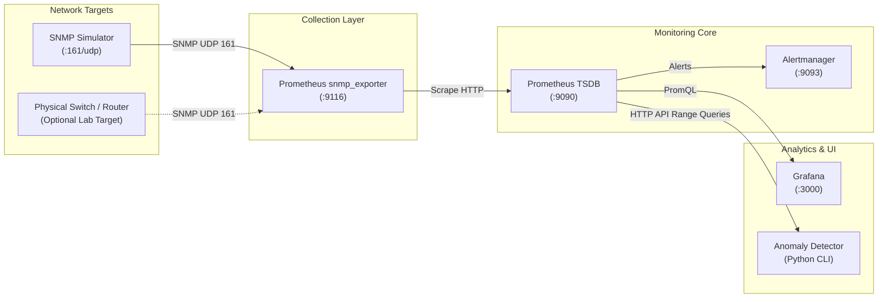

# Centralized Network Monitoring System

> **Undergraduate Thesis Project**  
> **Institution**: University of Transport Ho Chi Minh City (UTH), Department of Information Technology  
> **Author**: Nguyen Thanh Tri (Nguyễn Thành Trí)  
> **ORCID**: [https://orcid.org/0009-0006-2800-2798](https://orcid.org/0009-0006-2800-2798)  

[](https://github.com/nguyen-tri-Cyber/centralized-network-monitoring/actions)
[](LICENSE)


---

## 1. Overview & Motivation

Modern network infrastructures require continuous, granular, and automated observability to prevent outages, detect interface saturation, and maintain service-level objectives (SLOs). Traditional monitoring architectures often suffer from proprietary lock-in, heavy relational database overhead, and cumbersome manual configuration.

This repository provides an open-source, fully reproducible **Centralized Network Monitoring System** developed as an undergraduate thesis. Built around the cloud-native observability stack (**SNMP**, **Prometheus**, **Alertmanager**, and **Grafana** with **Docker Compose**), this system delivers:
- **Declarative GitOps Configuration**: Monitoring targets, scrape schedules, alert rules, and dashboards are maintained as version-controlled code.
- **Dimensional Telemetry**: Metric streams are tagged with descriptive labels (`instance`, `ifIndex`, `ifDescr`), enabling ad-hoc PromQL aggregations.
- **Automated Alert Lifecycle**: Real-time evaluation of device reachability, interface state transitions, traffic saturation, and packet error rates.
- **Reproducible Test Target**: An integrated SNMPv2c simulator container emulating MIB-II network interfaces, allowing full end-to-end evaluation without physical network switches.
- **Statistical Anomaly Detection**: An explainable, lightweight Python module computing dynamic rolling z-scores and EWMA baselines over the Prometheus HTTP API.

---

## 2. Architecture



---

## 3. Implementation Status

| Capability / Component | Status | Details |
|---|---|---|
| **SNMP Exporter Bridge** | **Implemented** | Pinned `prom/snmp-exporter:v0.26.0` using compiled `if_mib` module. |
| **Prometheus TSDB Core** | **Implemented** | Pinned `prom/prometheus:v2.54.1` with 15s scrape interval, relabeling, and TSDB retention. |
| **Alert Rules Configuration** | **Implemented** | Rules for `SNMPTargetDown`, `NetworkInterfaceDown`, `HighInterfaceUtilization`, `InterfaceErrorsDetected`, `InterfaceDiscardsDetected`, `HighSNMPScrapeDuration`. |
| **Alertmanager Integration** | **Implemented** | Pinned `prom/alertmanager:v0.27.0` with grouping, inhibition, and webhook placeholder. |
| **Grafana Provisioning** | **Implemented** | Automated datasource and dashboard provisioning (`config/grafana/provisioning/`). |
| **Grafana Network Dashboard** | **Implemented** | Interactive panels using real `if_mib` metrics (Status, Uptime, Traffic bps, Errors, Discards, Inventory). |
| **SNMP Simulator Target** | **Implemented** | Debian-based container running `snmpd` exposing MIB-II / `if-mib` interfaces. |
| **Statistical Anomaly Detector** | **Implemented** | Rolling Z-score and EWMA algorithms with Prometheus HTTP API client and comprehensive unit tests. |
| **CI / Automated Validation** | **Implemented** | GitHub Actions workflow verifying YAML syntax, `docker compose config`, `promtool`, and unit tests. |
| **Automated Benchmarks on Physical Switches** | **Planned** | Hardware evaluation on Cisco/MikroTik physical testbed `[TODO: author to measure in physical lab]`. |
| **SNMPv3 USM AuthPriv Encryption** | **Planned** | Encrypted transport for enterprise production networks. |
| **Streaming Telemetry (gNMI / gRPC)** | **Planned** | High-cadence push telemetry integration. |

---

## 4. Quick Start

### Prerequisites
- Docker Engine 20.10+ and Docker Compose v2.0+ (Docker Desktop on Windows/macOS).
- Python 3.10+ (for validation scripts and anomaly detector).

### Launching the Monitoring Stack

```bash
# 1. Clone repository
git clone https://github.com/nguyen-tri-Cyber/centralized-network-monitoring.git
cd centralized-network-monitoring


# 2. Start stack using helper script
# Linux / macOS:
bash scripts/up.sh

# Windows (PowerShell):
powershell -ExecutionPolicy Bypass -File .\scripts\up.ps1
```

### Accessing the Web Consoles
- **Grafana Dashboard**: [http://localhost:3000](http://localhost:3000) (User: `admin`, Password: `admin_lab_change_me`)
- **Prometheus UI**: [http://localhost:9090](http://localhost:9090)
- **Alertmanager UI**: [http://localhost:9093](http://localhost:9093)
- **SNMP Exporter**: [http://localhost:9116](http://localhost:9116)

---

## 5. Repository Structure

```
centralized-network-monitoring/
├── deploy/                      # Docker Compose & deployment configuration
│   ├── docker-compose.yml       # Pinned multi-container stack definition
│   └── .env.example             # Safe laboratory environment defaults
├── config/                      # Service configurations
│   ├── prometheus/              # Prometheus scrapers and alert rules
│   │   ├── prometheus.yml
│   │   └── alert.rules.yml
│   ├── alertmanager/            # Alertmanager routing and receivers
│   │   └── alertmanager.yml
│   ├── grafana/                 # Grafana automated provisioning
│   │   ├── provisioning/        # Datasource and dashboard providers
│   │   └── dashboards/          # Network Observability dashboard JSON
│   └── snmp/                    # SNMP exporter reference configs & generator notes
│       ├── snmp.yml
│       └── README.md
├── simulators/                  # Reproducible test targets
│   └── snmp/                    # Containerized SNMPv2c simulator (Debian + snmpd)
├── src/                         # Source code modules
│   └── anomaly_detector/        # Statistical anomaly detector (Z-score, EWMA)
├── scripts/                     # Cross-platform helper scripts
│   ├── up.sh / up.ps1           # Stack launch scripts
│   ├── down.sh / down.ps1       # Stack teardown scripts
│   └── validate.py / validate.sh# Config linting & validation runners
├── tests/                       # Unit tests & schema validation
│   ├── test_anomaly_detector.py # Algorithmic tests on synthetic time-series
│   └── test_configs.py          # YAML syntax, compose pins, and dashboard checks
├── docs/                        # Academic thesis documentation
│   ├── architecture.md          # Architectural components & scrape flow
│   ├── design-decisions.md      # Comparative analysis (Prometheus vs Zabbix/LibreNMS/Nagios)
│   ├── evaluation-plan.md       # Research questions, metrics & measurement methodology
│   └── setup-lab.md             # Step-by-step lab setup & troubleshooting
├── legacy/                      # Preserved preliminary exploratory prototypes
│   └── zabbix-lab/              # Prior Zabbix 7.4 prototype files and automation
├── .github/workflows/ci.yml     # Continuous integration workflow
├── Makefile                     # Command shortcut targets (up, down, validate, test)
├── CITATION.cff                 # Academic citation metadata
├── LICENSE                      # MIT License
└── README.md
```

---

## 6. Testing & Validation

Run all configuration validations and unit tests locally:

```bash
# Execute validation script
python scripts/validate.py

# Or run unit tests directly
python -m unittest discover -s tests -v
```

---

## 7. Limitations & Honest Academic Scope

1. **Laboratory Environment**: This system is designed for experimental evaluation, research, and educational demonstration. It is not hardened for production environments (TLS termination, authentication proxies, and network firewalls must be added before production use).
2. **Containerized Emulation**: Metrics generated by `snmp-simulator` reflect Linux virtual network interfaces (`veth`, `lo`). Hardware-specific ASIC metrics (e.g., optical power, switch fabric backplane buffers) require physical network switches.
3. **Statistical Anomaly Detection Scope**: The rolling z-score and EWMA detectors are designed for explainable, short-term anomaly detection. They assume locally stationary variance and do not perform long-term seasonal forecasting without external periodic decomposition.

---

## 8. AI Assistance Disclosure

In accordance with academic transparency standards, AI coding assistants were used for parts of code structure, configuration scaffolding, and documentation drafting, and the author reviewed, tested, and validated all output.

---

## 9. License

This project is licensed under the [MIT License](LICENSE).
