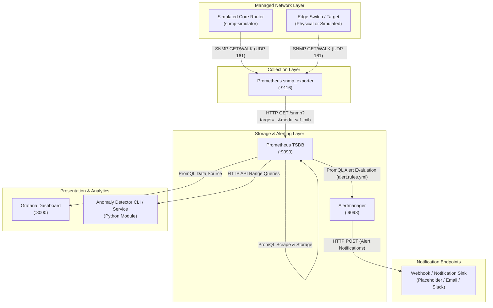

# System Architecture

## 1. High-Level Architecture Overview

The Centralized Network Monitoring System is built upon a cloud-native, pull-based observability architecture designed for heterogeneous network infrastructures. It decouples metric acquisition, storage/evaluation, alerting, and visualization into modular microservices running in containerized environments.

---

## 2. Core Components and Roles

### 2.1 Managed Network Targets (`snmp-simulator`)
- **Role**: Emulates SNMP-capable managed network devices (e.g., core switches, edge routers, Linux hosts).
- **Protocol**: Standard SNMPv2c / UDP 161.
- **MIBs Supported**: RFC 1213 (`system`) and RFC 2863 (`if-mib` / `ifMIB`), providing interface status (`ifOperStatus`), traffic octets (`ifHCInOctets`, `ifHCOutOctets`), packet errors (`ifInErrors`, `ifOutErrors`), and discards (`ifInDiscards`, `ifOutDiscards`).

### 2.2 SNMP Exporter (`snmp-exporter`)
- **Role**: Acts as an HTTP-to-SNMP bridge. When Prometheus requests a scrape for a target, `snmp_exporter` performs the SNMP walk on the target, parses the ASN.1 OID responses into Prometheus metric samples with dimensional labels, and returns them as plaintext Prometheus exposition format over HTTP.
- **Port**: `9116/tcp`.

### 2.3 Prometheus Server (`prometheus`)
- **Role**: Time-Series Database (TSDB) and query engine.
- **Scrape Mechanics**: Employs pull-based periodic polling (default 15s interval) using target relabeling.
- **Rule Engine**: Evaluates alert expressions (`alert.rules.yml`) every 15 seconds against ingested metric samples and forwards active alert states to Alertmanager.
- **Port**: `9090/tcp`.

### 2.4 Alertmanager (`alertmanager`)
- **Role**: Manages the alert lifecycle: deduplication, grouping, rate-limiting, inhibition, and routing to external notification endpoints.
- **Inhibition**: Suppresses low-level interface warning alerts when the parent device itself is down (`SNMPTargetDown`).
- **Port**: `9093/tcp`.

### 2.5 Grafana (`grafana`)
- **Role**: Real-time observability UI and operational dashboard.
- **Provisioning**: Datasources and dashboards are automatically loaded from configuration files at startup (`config/grafana/provisioning/`), ensuring reproducible zero-touch configuration.
- **Port**: `3000/tcp`.

### 2.6 Anomaly Detection Module (`src/anomaly_detector`)
- **Role**: Standalone analytics engine querying the Prometheus HTTP API to compute dynamic statistical baselines (Rolling Z-Score and EWMA) for detecting sudden anomalies or gradual degradation.

---

## 3. Data Flow & Scrape Relabeling Mechanics

Prometheus does not connect directly to network switches via SNMP; instead, it delegates SNMP communication to `snmp_exporter`. The data acquisition sequence follows:

1. **Scheduled Polling**: Prometheus triggers a scrape for target `snmp-simulator:161`.
2. **Relabeling**:
   - The address `snmp-simulator:161` is mapped to parameter `__param_target`.
   - The instance label is assigned `instance="snmp-simulator:161"`.
   - The destination address is rewritten to `snmp-exporter:9116`.
3. **SNMP Walk**: `snmp_exporter` queries the target via UDP 161 using the configured `if_mib` module and credentials.
4. **Metric Translation**: Raw OID values are transformed into Prometheus time series (e.g., `1.3.6.1.2.1.2.2.1.8.1 -> ifOperStatus{ifIndex="1", ifDescr="eth0"} 1`).
5. **Storage & Evaluation**: Prometheus stores the samples in memory/TSDB chunks and executes alerting rules.

---

## 4. Port Map and Network Boundaries

| Service | Container Port | Default Host Port | Protocol | Scope | Purpose |
|---|---|---|---|---|---|
| `prometheus` | 9090 | 9090 | TCP / HTTP | Host / Bridge | Metrics UI, TSDB API |
| `snmp-exporter` | 9116 | 9116 | TCP / HTTP | Host / Bridge | SNMP scrape endpoint |
| `alertmanager` | 9093 | 9093 | TCP / HTTP | Host / Bridge | Alert clustering & webhook dispatch |
| `grafana` | 3000 | 3000 | TCP / HTTP | Host / Bridge | Visualization web UI |
| `snmp-simulator` | 161 | 161 | UDP / SNMP | Host / Bridge | Simulated network device agent |

---

## 5. Security Posture and Lab Isolation Notes

- **Network Scope**: All services run inside an isolated Docker bridge network (`monitoring_net`). Host bindings can be restricted to `127.0.0.1` by prefixing ports in `.env` (e.g., `127.0.0.1:9090:9090`).
- **SNMP Credentials**: SNMPv2c uses unencrypted cleartext community strings. In production networks, SNMPv3 with USM authentication (`authPriv`, SHA256/AES) is required.
- **Production Hardening Notice**: This repository provides a laboratory demonstration and research benchmark environment. It does not include TLS termination, reverse proxy mutual authentication (mTLS), or single-sign-on (SSO).
