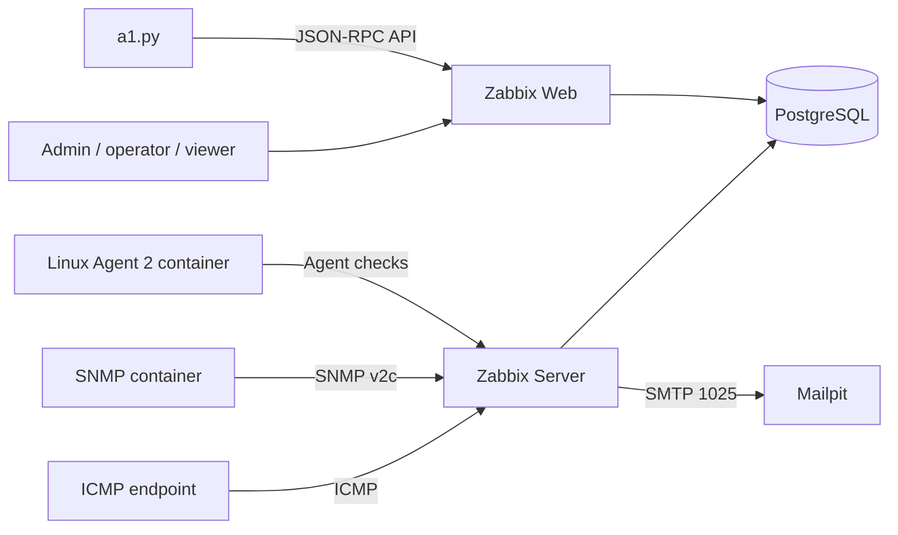

# Kiến trúc A1 Lab

Mọi service ở Compose network `lab`; chỉ Zabbix Web và Mailpit công bố cổng trên `127.0.0.1`. `db_data` giữ cơ sở dữ liệu qua lần `docker compose down`.

## Luồng dữ liệu và cảnh báo

1. Zabbix Server hỏi ICMP, SNMP và Agent theo template 7.4; chỉ số đi vào PostgreSQL.
2. Template `ICMP Ping` yêu cầu ba lần thất bại liên tiếp trước trigger mất kết nối. Trigger độ trễ riêng của A1 yêu cầu hai mẫu vượt 200 ms.
3. Sự cố của nhóm `A1 Lab` đi qua action `A1 Lab - Email su co` tới user `a1-operator` qua media type `A1 Lab Mailpit`.
4. Dashboard đọc item/problem theo quyền từng user. Mailpit lưu email thử nghiệm.
5. `a1.py` tạo cấu hình idempotent, đọc trạng thái và xuất bằng chứng. Mã không sửa bảng Zabbix trực tiếp.

## Ánh xạ yêu cầu bắt buộc

| Yêu cầu | Cấu phần / bằng chứng |
|---|---|
| FR01 | Host group và 3 host qua `provision`, TC01 |
| FR02–FR03 | Template ICMP Ping, Latest data, TC02/03/04/05/06 |
| FR04 | SNMP interface traffic, TC07 |
| FR05 | Linux template và item root disk, TC02/08 |
| FR06 | Dashboard `A1 Lab - Tong quan` với thẻ chỉ số và đồ thị |
| FR07 | Trigger template/trigger A1 và recovery, TC03/04/06 |
| FR08 | Action Email → Mailpit, TC09 |
| FR09 | Zabbix event history và xuất JSON/Markdown, TC12 |
| FR10 | Admin, operator, viewer; quyền host group, TC10 |
| FR11 | Nhóm `A1 Lab/Zone A` và `A1 Lab/Zone B` qua `provision` |
| FR12 | `a1.py report --hours 24` xuất số liệu thống kê JSON/Markdown và mẫu thô CSV |
| FR13 | Bản đồ host logic `A1 Lab - Logical host map` trên dashboard |

FR11–FR13 là phần mở rộng trong phạm vi lab. Bản đồ thể hiện ba host thử nghiệm và trạng thái của chúng, không phải topology mạng vật lý. Báo cáo chỉ tổng hợp cửa sổ dữ liệu có thật tại thời điểm chạy; chưa có lịch chạy tự động hoặc chuỗi số liệu dài hạn.

## Ánh xạ yêu cầu phi chức năng

| Yêu cầu | Cách kiểm chứng trong lab |
|---|---|
| NFR01 | `verify` kiểm tra mẫu mới; TC05 kiểm tra lỗi ngắn; TC11 xác nhận dữ liệu còn sau restart. Không suy ra độ sẵn sàng dài hạn. |
| NFR02 | Cổng web/Mailpit chỉ bind localhost, bí mật tách khỏi mã nguồn, `secure-admin` đổi mật khẩu; TC10 kiểm tra viewer. SNMPv2c chỉ nằm trong Docker lab. |
| NFR03 | Phạm vi 3 host và chu kỳ template Zabbix; `report` xuất số mẫu thực. Không cam kết ngưỡng hiệu năng cho mạng lớn. |
| NFR04 | `backup.ps1`, `verify-backup.ps1` và `restore.ps1`, cùng hướng dẫn trong `docs/OPERATIONS.md`. |
| NFR05 | Dashboard, biểu đồ, Problems, Latest data và sơ đồ host logic. |
| NFR06 | `verify`, TC01–TC12, JSON/Markdown/CSV và thời điểm đo trong `output/`. |

## Giới hạn đo lường

Container Agent là nguồn dữ liệu Linux thử nghiệm; chỉ số không đại diện toàn bộ máy Windows hay LIC. SNMP container mô phỏng thiết bị có interface; traffic sinh bằng ping nội bộ. ICMP thất bại chỉ chứng minh endpoint không phản hồi từ Zabbix tại thời điểm đo. T_det/T_notify được tính từ timestamp sự kiện và Mailpit, có sai số ít nhất một chu kỳ polling và độ phân giải giây của API.
